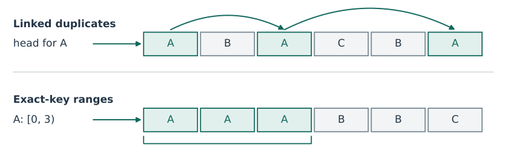

# Unchained Hash Join Research

When does the cost of building contiguous ranges pay off in a hash join?
This study integrates the layout into DuckDB 1.5.6 and Apache DataFusion 55.2.0
and measures both against their native execution paths on one thread.

**DataFusion SNAP: 73% less total query time. DuckDB JOB: 0.948× stock-to-policy time ratio.**
These are within-engine comparisons on different workloads. The break-even
model links the difference to the cost of moving build rows, the keys reached
by probes, and the layout of the payload.

[Paper (PDF)](paper/article.pdf) · [Reproduce an Enron join](datafusion/docs/results.md#run-the-enron-two-hop-query) ·
[DuckDB implementation](duckdb/README.md) · [DataFusion implementation](datafusion/README.md) ·
[Cite this work](CITATION.cff) · [Release v1.0.0](https://github.com/rusanoph/unchained-hash-join-research/releases/tag/v1.0.0)

[Build DuckDB](duckdb/README.md#build-and-verify) ·
[Build DataFusion](datafusion/README.md#build-and-verify) ·
[Rebuild the paper](paper/README.md) · [Original Unchained paper](https://doi.org/10.1145/3662010.3663442)

## Compared with the native join

| Engine and comparison | Workload | Result |
| --- | --- | ---: |
| DuckDB stock vs contiguous-row policy | 35 SNAP graph queries | 1.068× [1.059, 1.077] |
| DuckDB stock vs contiguous-row policy | 113 JOB queries | 0.948× [0.945, 0.951] |
| DataFusion native vs auto at 200K build rows | 35 SNAP graph queries | 73% less total time with auto |
| DataFusion native vs auto at 200K build rows | 100 JOB queries | 11.7% less total time with auto |

DuckDB reports geometric means of per-query stock-to-policy time ratios with
95% confidence intervals. DataFusion compares sums of per-query median times.
Both DataFusion modes use the same build of the engine. Native mode uses the
engine's own join index, and auto can select CSR. Auto selected CSR in 24 of
35 SNAP queries and 56 of 100 JOB queries. On DuckDB JOB 22d, the experimental
join scattered 5.54 million build rows for three probe rows.
[DuckDB measurements](duckdb/docs/results.md) · [DataFusion measurements](datafusion/docs/results.md#native-join-versus-auto-mode)

## DataFusion follow-up on the auto threshold

Lowering the threshold from 200K to 50K yielded a **2.177×** speed ratio
[2.156, 2.212] on 12 held-out Enron and HepPh graph queries and **1.004×**
[0.977, 1.016] on 31 analytical queries whose index selection changed.
These ratios are medians of paired block ratios of summed query times, with
95% confidence intervals. The 50K setting is supported for the tested
graph workload. [Threshold measurements](datafusion/docs/results.md#lowering-the-build-threshold-in-auto-mode)

## Implementations and evidence

- **[DuckDB](duckdb/README.md)** contains the C++ core, the v17 engine
  patch, and a SQL worker. The smoke test checks result rows against
  SQLite and confirms the experimental path and native fallback.
  [Measurements and per-query evidence](duckdb/docs/results.md)
- **[DataFusion](datafusion/README.md)** contains the Rust CSR core,
  the v10b engine patch, and a SQL worker. The smoke test checks both
  CSR layouts and the small-build fallback. The Enron example runs
  one holdout query at both thresholds and checks the exact result and
  the index each run actually built.
  [Measurements and Enron example](datafusion/docs/results.md)
- **[Article](paper/README.md)** traces both layouts from construction through
  SQL execution and derives a break-even condition for probe savings. Its
  measured figures can be regenerated from the bundled engine evidence.

The benchmark tables summarize recorded campaigns. The build and
smoke commands verify the supplied code on small fixtures.
The v1.0.0 release includes an archive of 24,282 per-observation
measurements with a Python script that recomputes the main results.
[Download the measurement archive](https://github.com/rusanoph/unchained-hash-join-research/releases/download/v1.0.0/unchained-hash-join-measurements-v1.0.0.zip) · [Cite the dataset on Zenodo](https://doi.org/10.5281/zenodo.24519430)

[CI](.github/workflows/verify.yml) tests both standalone cores and
rebuilds the figures and paper.

## Licenses

The independent implementations are MIT-licensed.
The patches retain the [DuckDB license](duckdb/licenses/duckdb-LICENSE.txt)
and the [Apache DataFusion license](datafusion/licenses/datafusion-LICENSE.txt)
and [notice](datafusion/NOTICE), respectively.
[DuckDB implementation license](duckdb/LICENSE) · [DataFusion implementation license](datafusion/LICENSE)

The code licenses cover the implementations. Contact the author for
reuse permissions for the article, figures and research evidence.
