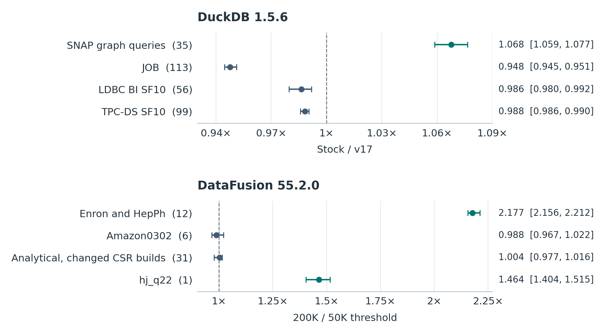

# When Contiguous Hash Joins Pay Off in DuckDB and DataFusion

**Maxim Rusanov**

## Abstract

Putting matching build rows next to each other makes them cheaper to enumerate
during a hash join. It also takes work to put them there. I implemented
contiguous build-side layouts in DuckDB 1.5.6 and Apache DataFusion 55.2.0
and measured each against its native join on one thread. In DuckDB, the final
prototype was 1.068× faster by geometric mean on 35 graph queries, but slower
on the Join Order Benchmark (JOB), LDBC BI and TPC-DS. A profile of JOB 22d
showed where the time went.
The join scattered 5.54 million build rows for three probe rows. In
DataFusion, lowering the row threshold for a contiguous index sped up 12
held-out graph queries by 2.177× [2.156, 2.212], including Parquet reads.
The same change gave 1.004× [0.977, 1.016] on 31 analytical queries where
it changed index selection. I kept the lower threshold as a workload setting.

## From table layout to SQL execution

A hash join builds an index over one input. For each row from the other
input, it looks up candidates and checks which keys match. With a linked
chain, visiting one candidate reveals the address of the next. When many
rows have the same key, the probe may follow that chain many times.
Birler et al. group tuples by hash prefix into contiguous ranges and use
the directory to locate the ranges [1]. Their measurements in Umbra
motivated the two implementations here.

The DuckDB prototype integrates with the existing hash join. It counts
rows by hash prefix, computes offsets and scatters the build rows into
those ranges. The v17 build can use the sink's radix partitions to limit
the active scatter region. Exact-key ranges group equal keys within a
prefix bucket and reduce candidate scanning. The timed configuration
uses the native join when the build falls below 8 MiB of staging data
and preserves the native perfect-hash path where available. The
experimental path handles serial inner equijoins on a single
32- or 64-bit integer key.

In DataFusion, the experimental index stores row IDs in a compressed
sparse row (CSR) layout. Dense integer keys address exact ranges.
General keys use a hash directory and retain key equality checks.
DataFusion still owns the Arrow batches and the join's output rules.
The optional payload permutation applies only to large, unordered,
duplicate-heavy builds where the join does not need a final pass over
the build side. In `auto` mode, the v10b gate samples key multiplicity
and checks build size and the estimated probe-to-build ratio before
building the index. The threshold experiment changed the build-row
floor from 200,000 to 50,000 while holding the rest of that gate fixed.

Both engines expose the actual runtime path. A physical plan with a hash
join is insufficient to tell whether the contiguous index was built.

## Measuring the operator in its engine

Each timing comparison stayed within one engine and used one logical
CPU on a WSL2 host with an AMD Ryzen 5 7500F. A fresh worker ran each
observation. Query order and
variant order were randomized within blocks. A second copy of the native
arm, the A/A control, tracked noise from repeating the comparison with
the same implementation. Treatment coverage was checked from runtime
records, and output row counts and result digests were compared across
arms. The validation compared 18 graph results with an independent
grouped calculation in DuckDB. It computed the pair count for each key
as the product of the two group counts and the payload sum by weighting
group sums by the opposite group's count. All 18 exact integer
`COUNT` and `SUM` pairs matched. A separate DataFusion differential
suite covered 43 cases in six modes, including nulls, outer and
semi/anti joins, composite keys and output batches of one row.
The DataFusion digest rounds floating-point values to six significant
digits, so a matching digest is weaker evidence for floating-point
queries than the integer oracle is for the graphs.

For DuckDB, the cohort statistic is the geometric mean of per-query
median paired ratios. For the DataFusion threshold experiments, each
block contributes a ratio of summed query times. The cohort statistic is
the median of these block ratios. Both use block bootstrap intervals.
The panels below answer different questions and use different scales.

**Figure 1.** Points show speed ratios and whiskers show block-bootstrap
95% intervals. The DuckDB comparison uses stock DuckDB as the numerator.
The DataFusion comparison uses the 200K threshold as the numerator.

## DuckDB

The final v17 configuration improved the graph cohort by 1.068×
[1.059, 1.077]. It was especially useful on builds with permuted graph
rows. For the outgoing-star queries, the geometric mean was 1.170×
in permuted order and 0.932× in the order delivered with the input.
The same configuration was slower than stock on all three analytical
suites. The held-out TPC-DS SF10 cohort reached 0.988× [0.986, 0.990],
and JOB [3] reached 0.948× [0.945, 0.951]. The local SQL port of LDBC BI
reached 0.986× [0.980, 0.992]. Its unrounded lower bound was 0.97959.
The registered condition for continuing, a lower bound of at least
0.98 on both JOB and LDBC BI, failed.
[Suite analyses and settings](../duckdb/docs/results.md)

JOB 22d illustrates how a cheap probe can make construction dominant.
In a diagnostic run, the largest hash join spent 345 ms scattering
5,536,051 build rows and 25 ms grouping exact keys. It received three
probe rows. A follow-up turned off exact ranges, removing both the key
grouping step and the associated probe refinement. In 192 observations
across four JOB and two WebGoogle queries, plans and results matched.
None of the four JOB intervals excluded one, and both WebGoogle
queries slowed down. JOB 22d still took 923 ms with ranges off, against
552 ms for stock DuckDB in that session. The ablation gave no reason
to drop exact ranges from the tested configuration.
[Ablation results](../duckdb/docs/evidence/exact-ranges.json)

The profiled join staged 73 bytes per build row. Scattering full rows
therefore writes about 385 MiB of row data. Scattering 64-bit row
references would write about 42 MiB of references and introduce an
indirection when fetching payloads. That arithmetic identifies an
experiment on build traffic. The row-reference layout was not implemented
or timed in DuckDB.

## DataFusion

The original single-thread campaigns compared the 200K `auto` gate with
native DataFusion. Total time combines the per-query median times, so
long-running queries contribute more to it than short ones.

| Workload | Queries | Queries that used CSR | Change in total query time |
| --- | ---: | ---: | ---: |
| SNAP graph self-joins | 35 | 24 | −73% |
| JOB | 100 | 56 | −11.7% |
| TPC-H SF10 | 20 | 3 | −2.6% |
| TPC-DS SF10 | 94 | 24 | −0.1% |
| DataFusion hj | 25 | 0 | +0.2% |

Five of the 99 TPC-DS queries did not complete the native coverage pass.
The table reports the 94 that completed. The original JOB totals
use preloaded tables. On a separate Parquet run for JOB queries 6a–6f,
per-query speed ratios were 1.01–1.26× and most were near 1.03×.
Those timings include scan and decode, which dilutes operator gains.
[Native versus auto records](../datafusion/docs/results.md)

The graph threshold holdout used Enron, HepPh and Amazon0302 from SNAP [4],
each with two-hop and two star queries in original and deterministically
shuffled order. Enron and HepPh fell between the two build thresholds.
At 200K none of their 12 queries used CSR. At 50K all 12 did, yielding
2.177× [2.156, 2.212]. On Amazon0302, both settings built CSR and the
ratio was 0.988× [0.967, 1.022]. All 576 observations included Parquet
reads. On Enron and HepPh the A/A ratio was 1.002× [0.989, 1.014],
and the largest per-query rise in median process peak RSS was 0.7%
across the holdout.
[Holdout statistics](../datafusion/docs/evidence/snap-threshold.json)

To test transfer beyond graphs, I screened 97 analytical queries with
a previously observed build in the 50K–200K band and a prior median
end-to-end process time of at most five seconds. Lowering the threshold
changed the set of CSR builds in 31 queries. Those queries and eight
unchanged controls were timed in eight randomized blocks with four arms.
Timing began after table loading. The 31 changed queries yielded
1.004× [0.977, 1.016] together. In `hj_q22`, a native array index
for 100,000 rows changed to exact CSR and the query reached
1.464× [1.404, 1.515]. Three JOB queries had pointwise intervals
below one, with small slowdowns. The cohort result supported keeping
the 200K default and using 50K for the tested graph workload.
[Analytical audit statistics](../datafusion/docs/evidence/natural-threshold.json)

## Scope

These are single-thread measurements from one machine and two specific
integrations. The experiments measure complete SQL statements under
controlled worker configurations, so the results include the cost of
each engine's native structures, output materialization and runtime
decision logic. Different baselines, operator coverage and cohort
statistics prevent a DuckDB-versus-DataFusion ranking. The DuckDB LDBC
BI results cover a local port on the initial snapshot. The TPC suite
results are research measurements under the stated configuration.
The natural threshold screen excludes heavier queries and builds
outside its row band.

The outcomes agree with an observation from earlier work on partitioned
joins in Umbra [2]. An index can look good in an isolated kernel and
still lose once the full build and probe run inside a query. The two
examples here show why build size alone is a weak selector. A graph
probe may visit many duplicate matches, while JOB 22d pays for millions
of build rows and then probes only three times.

## Artifacts

Each engine directory contains a pinned engine revision, its integration,
source-level tests, a SQL worker, a smoke test that verifies runtime
selection, and per-query aggregates from the campaigns. The published
ratios come from the recorded campaigns. The smoke tests exercise
small fixtures supplied with the source.
[DuckDB](../duckdb/README.md) ·
[DataFusion](../datafusion/README.md) ·
[Figure data](results.csv)

## References

1. Altan Birler, Tobias Schmidt, Philipp Fent, and Thomas Neumann.
   *Simple, Efficient, and Robust Hash Tables for Join Processing*.
   DaMoN 2024. [DOI](https://doi.org/10.1145/3662010.3663442)
2. Maximilian Bandle, Jana Giceva, and Thomas Neumann.
   *To Partition, or Not to Partition, That is the Join Question in a Real System*.
   SIGMOD 2021. [DOI](https://doi.org/10.1145/3448016.3452831)
3. Viktor Leis et al. *How Good Are Query Optimizers, Really?*
   PVLDB 9(3), 2015. [DOI](https://doi.org/10.14778/2850583.2850594)
4. Stanford Network Analysis Project. Graph datasets
   [Enron](https://snap.stanford.edu/data/email-Enron.html),
   [HepPh](https://snap.stanford.edu/data/ca-HepPh.html), and
   [Amazon0302](https://snap.stanford.edu/data/amazon0302.html).
